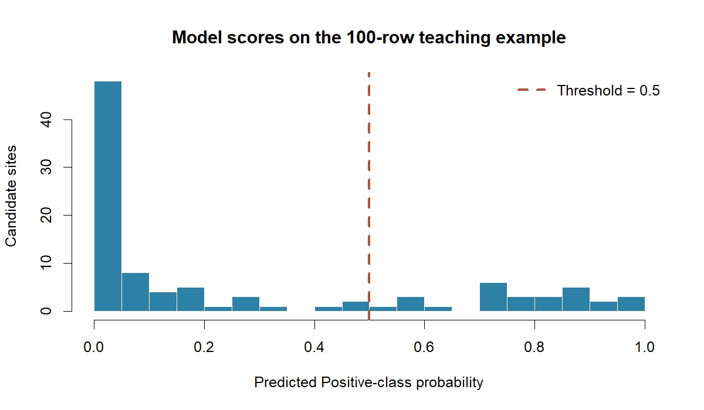

# m6APrediction

An educational BIO215 R package for predicting candidate RNA m6A sites with
the fitted random forest supplied in Practical 6. The package accepts a
five-nucleotide DNA context and transcript-level features, and returns a
Positive-class probability and a threshold-based status. It is a course
demonstration, not a clinically validated diagnostic tool.

## Installation

Once the public repository is published, install it with
`remotes::install_github("be-neuroflow/m6APrediction")`. To install from a
source archive instead, use:

```r
install.packages("m6APrediction_1.0.0.tar.gz", repos = NULL, type = "source")
library(m6APrediction)
```

The package depends on `randomForest`; R will need access to the dependency
when installing the source archive.

## Input features

`prediction_multiple()` expects a data frame with these seven columns:
`gc_content`, `RNA_type`, `RNA_region`, `exon_length`,
`distance_to_junction`, `evolutionary_conservation`, and `DNA_5mer`.
The training data used log2-transformed length and distance values. The
five-base context should have A as the central base. Consult the bundled
example file for the expected feature layout and category spelling.

## Batch prediction

```r
library(m6APrediction)
ml_fit <- readRDS(system.file("extdata", "rf_fit.rds",
                             package = "m6APrediction", mustWork = TRUE))
example_df <- read.csv(system.file("extdata", "m6A_input_example.csv",
                                   package = "m6APrediction", mustWork = TRUE))
out <- prediction_multiple(ml_fit, head(example_df, 3), positive_threshold = 0.6)
out[, c("predicted_m6A_prob", "predicted_m6A_status")]
```

With the bundled files, the first three probabilities are `0.876`, `0.000`,
and `0.498`; their statuses at threshold 0.6 are Positive, Negative, Negative.

## Single-site prediction

```r
library(m6APrediction)
ml_fit <- readRDS(system.file("extdata", "rf_fit.rds",
                             package = "m6APrediction", mustWork = TRUE))
prediction_single(ml_fit, gc_content = 0.6, RNA_type = "mRNA",
                  RNA_region = "CDS", exon_length = 12,
                  distance_to_junction = 5, evolutionary_conservation = 0.8,
                  DNA_5mer = "GGACA", positive_threshold = 0.5)
```

For the bundled model, this yields the named character vector with probability
`"0.51"` and status `"Positive"`. Equality with the threshold is Negative.

## Example output



The figure shows model scores for the supplied 100-row teaching example only.
It is **not** a ROC or precision-recall curve, nor an independent performance
estimate: the example table has no verified outcome labels. Replace or augment
this figure with a validated evaluation from your own held-out labelled data
if that analysis is available.

## Check the package

From the package project root, run `devtools::check(args = "--no-manual",
cran = FALSE)`. The two exported functions are documented as
`?prediction_multiple` and `?prediction_single`. The included model and CSV
are in `inst/extdata` and become available through `system.file()` after
installation.
